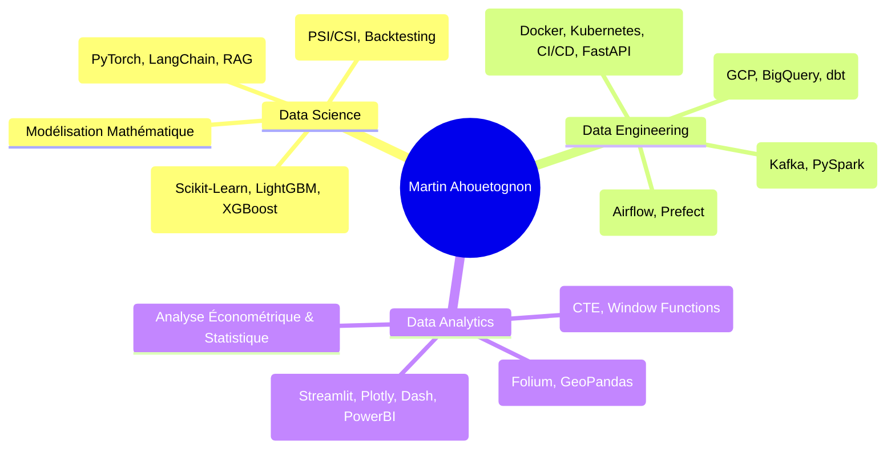

# Martin AHOUETOGNON

### 🎯 Ingénieur Data Science & IA | Double Compétence Data Engineering & Data Analytics
**Diplômé ENSAI (École Nationale de la Statistique et de l'Analyse de l'Information)**  
*Analyste Quantitatif PRO certifié • Ingénieur Statisticien Économiste (ENEAM)*

 

> *"Allier rigueur mathématique, robustesse d'ingénierie logicielle et clarté des insights business pour transformer la donnée brute en valeur stratégique."*

---

## 🌟 Choisissez un Portfolio selon vos besoins de recrutement

Pour faciliter votre évaluation de mes compétences techniques, mes réalisations sont structurées en **3 univers professionnels distincts** :

| 🧠 **Data Scientist** | ⚙️ **Data Engineer** | 📊 **Data Analyst** |
| :--- | :--- | :--- |
| **Orientation** : Modélisation, Finance Quant, IA & LLM | **Orientation** : Cloud, Streaming, Architecture & MLOps | **Orientation** : Dataviz, SQL Avancé & Business Insights |
| • Modélisation Risque de Crédit IRB (PD, LGD, EAD) • RAG multimodal avec OCR & LLMs • Package d'Audit & Validation de Modèles ML • Modélisation GLM du Risque Climatique | • Pipeline ETL automatisé & NLP juridique (Airflow, GCP) • Architecture Streaming temps réel (Kafka, PySpark) • Industrialisation MLOps (FastAPI, Docker, CI/CD) • Data Warehouse modélisé avec dbt & BigQuery | • Dashboard interactif de suivi du risque de crédit • Analyse de cohorte & segmentation RFM (SQL) • Analyse spatiale impact climatique & agriculture • Web Scraping & analyse du marché immobilier |
| [👉 Explorer le Portfolio DS](#-1-portfolio-data-science) | [👉 Explorer le Portfolio DE](#-2-portfolio-data-engineering) | [👉 Explorer le Portfolio DA](#-3-portfolio-data-analytics) |

---

## 🧠 1. Portfolio Data Science
> **Stack** : `Python`, `Scikit-learn`, `PyTorch`, `XGBoost`, `LightGBM`, `Statsmodels`, `LangChain`, `OpenAI API`, `HuggingFace`

1. **[credit-risk-irb-modeling](./data-science/01-credit-risk-irb-modeling/)** : Modélisation complète du risque de crédit selon l'approche IRB (Bâle II/III). Développement de modèles de régression logistique et d'arbres boostés pour la Probabilité de Défaut (PD), Perte en Cas de Défaut (LGD Hurdle) et Exposition au Moment du Défaut (EAD).
2. **[legal-financial-rag-llm](./data-science/02-legal-financial-rag-llm/)** : Architecture RAG intégrant OCR (Tesseract), Vector DB (Chroma/FAISS) et LLM pour l'interrogation sémantique et contextuelle de textes juridiques et financiers non structurés.
3. **[ml-model-validation-framework](./data-science/03-ml-model-validation-framework/)** : Package Python professionnel développé pour l'audit automatique et la validation de modèles ML en environnement bancaire (Population Stability Index PSI/CSI, calibration, dérive, explainability SHAP).
4. **[climate-risk-financial-loss-glm](./data-science/04-climate-risk-financial-loss-glm/)** : Quantification des pertes financières et modélisation de la probabilité de sinistre suite à des aléas climatiques (inondations) via des modèles linéaires généralisés (GLM Tweedie/Gamma).

---

## ⚙️ 2. Portfolio Data Engineering
> **Stack** : `Apache Airflow`, `Apache Kafka`, `PySpark`, `dbt`, `Google Cloud Platform (GCP)`, `BigQuery`, `Docker`, `Kubernetes`, `FastAPI`, `GitHub Actions`

1. **[legal-texts-etl-pipeline](./data-engineering/01-legal-texts-etl-pipeline/)** : Pipeline ETL automatisé orchestré avec Airflow pour l'ingestion quotidienne de décrets officiels, extraction de texte, nettoyage NLP et stockage dans GCP Cloud Storage et BigQuery.
2. **[realtime-streaming-kafka-spark](./data-engineering/02-realtime-streaming-kafka-spark/)** : Architecture de données en streaming temps réel ingérant des flux de marchés financiers via WebSockets, bufferisé par Apache Kafka, traité avec PySpark Streaming et stocké dans Redis et PostgreSQL.
3. **[mlops-scoring-fastapi-docker-cicd](./data-engineering/03-mlops-scoring-fastapi-docker-cicd/)** : Industrialisation et déploiement de modèles de Machine Learning sous forme de microservice API REST (FastAPI) conteneurisé avec Docker, pipeline CI/CD automatisé (linting, tests unitaires, build, smoke tests) et monitoring de drift.
4. **[data-warehouse-dbt-bigquery](./data-engineering/04-data-warehouse-dbt-bigquery/)** : Modélisation d'un Data Warehouse d'entreprise en schéma en étoile (tables de faits et dimensions) avec dbt (data build tool) sur BigQuery, documentation de lignage de données et tests d'intégrité automatisés.

---

## 📊 3. Portfolio Data Analytics
> **Stack** : `SQL Avancé (PostgreSQL / BigQuery)`, `Pandas`, `Plotly`, `Streamlit`, `PowerBI`, `Folium`, `Seaborn`

1. **[credit-risk-monitoring-dashboard](./data-analyst/01-credit-risk-monitoring-dashboard/)** : Dashboard analytique interactif de pilotage du risque de crédit permettant d'explorer les distributions de scores, les taux de défaut par segment et de simuler des stress tests macroéconomiques.
2. **[cohort-analysis-rfm-segmentation](./data-analyst/02-cohort-analysis-rfm-segmentation/)** : Analyse de cohorte mensuelle et segmentation client RFM avancée utilisant des requêtes SQL complexes (Window functions, CTEs) pour cibler la rétention et prévenir l'attrition (churn).
3. **[climate-agriculture-impact-analysis](./data-analyst/03-climate-agriculture-impact-analysis/)** : Analyse exploratoire approfondie et visualisations cartographiques interactives croisant données météorologiques historiques et rendements agricoles pour identifier les vulnérabilités régionales.
4. **[real-estate-scraping-market-analysis](./data-analyst/04-real-estate-scraping-market-analysis/)** : Pipeline de web scraping et étude économétrique de rentabilité locative sur le marché immobilier résidentiel, corrélant prix au m², attractivité géographique et dessertes de transport.

---

## 🛠️ Stack Technique & Boîte à Outils

---

## 🎓 Parcours Académique & Expériences Clés

- 🎓 **ENSAI (École Nationale de la Statistique et de l'Analyse de l'Information)** - Ingénieur Data Science & Ingénierie des Données (Double diplôme)
- 📜 **Analyste Quantitatif PRO** - Formation certifiante en modélisation financière et risque de crédit
- 🎓 **ENEAM** - Ingénieur Statisticien Économiste
- 💼 **Nexialog Consulting (Paris)** - Data Scientist : Modélisation des risques financiers, GLM & RAG/LLM
- 💼 **Crédit Logement (Paris)** - Data Scientist : Validation statistique de modèles ML & développement d'un package interne d'audit
- 💼 **Direction de l'Agriculture (Bénin)** - Analyste de Données : Prévisions agricoles et modélisation statistique

---

## 📬 Contact & Réseaux

- 📧 Email : [ahouetognonmartin@gmail.com](mailto:ahouetognonmartin@gmail.com)
- 💼 LinkedIn : [linkedin.com/in/martin-ahouetognon](https://www.linkedin.com)
- 📍 Localisation : France / Mobilité internationale
