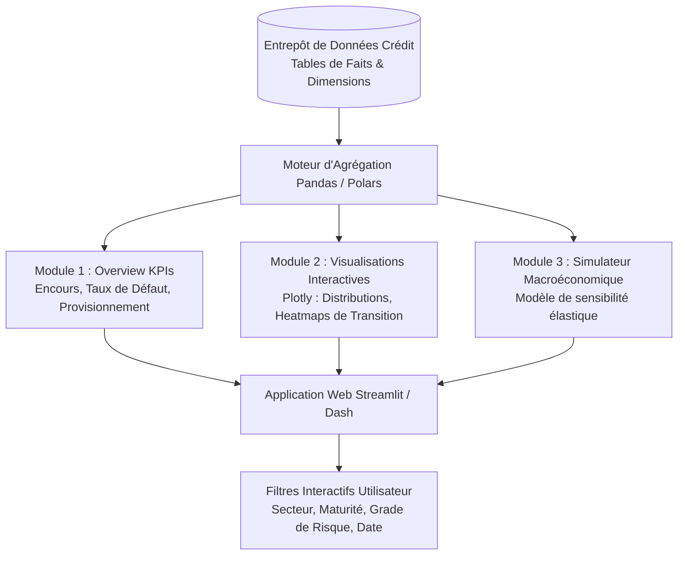

# 📊 Credit Risk Monitoring & Portfolio Stress-Testing Dashboard
[](https://www.python.org/)
[](https://streamlit.io/)
[](https://plotly.com/)
[](#)

> **Projet Data Analytics & Business Intelligence Financière**  
> Conception et déploiement d'un **dashboard web interactif de pilotage du risque de crédit bancaire**. Visualisation multidimensionnelle de la distribution des scores, suivi des taux de défaut par cohorte, matrices de transition de notation et simulateur de **stress-testing macroéconomique** en temps réel.

---

## 📌 Contexte Métier & Objectifs Décisionnels
Pour la direction des risques et les comités de crédit d'une banque, il est impératif de disposer d'indicateurs de synthèse fiables pour détecter les dégradations de qualité de portefeuille avant qu'elles ne se traduisent par des pertes effectives.

Cette application analytique fournit une vision à 360° du portefeuille de crédit :
1. **Surveillance des Expositions & Scores** : Exploration interactive des distributions de scores de crédit par produit (prêts immobiliers, crédits à la consommation, prêts pro).
2. **Matrices de Transition des Notations (Rating Migration)** : Suivi dynamique des migrations de risque d'un trimestre à l'autre (passage de note AAA à BBB, vers défaut D).
3. **Analyse des Taux de NPL (Non-Performing Loans)** : Découpage par segment démographique, secteur d'activité et ancienneté du prêt avec détection des anomalies.
4. **Moteur de Stress-Testing Macroéconomique** : Simulateur interactif permettant d'appliquer des chocs exogènes (hausse du taux d'intérêt BCE, flambée du taux de chômage, chute du PIB) et de recalculer instantanément le coût du risque et les provisions IFRS 9 (Stage 1, Stage 2, Stage 3).

---

## 📈 Indicateurs Clés de Performance (KPIs)

- **Total Outstanding Balance** : Encours global sous gestion et répartition par tranche de maturité.
- **NPL Ratio (%)** : Ratio de créances douteuses par rapport au portefeuille total.
- **Expected Credit Loss (ECL IFRS 9)** : Provisions requises sous scénario de base et scénarios dégradés.
- **Average Risk Grade & Drift** : Évolution de la note de crédit moyenne pondérée par les encours.

---

## 🏗️ Architecture du Dashboard



---

## 📁 Structure du Répertoire
```
├── data/
│   └── credit_portfolio_sample.parquet
├── src/
│   ├── analytics/
│   │   ├── kpi_calculator.py    # Calcul NPL, provisions IFRS 9
│   │   └── migration_matrix.py  # Matrices de transition de notation
│   ├── simulation/
│   │   └── macro_stress_engine.py # Modèle d'impact macroéconomique
│   └── ui/
│       ├── components.py        # Widgets et cartes métriques
│       └── charts.py            # Graphiques Plotly configurés
├── app.py                       # Point d'entrée Streamlit
├── requirements.txt
└── README.md
```

---

## 🚀 Lancement du Dashboard

```bash
# 1. Cloner et installer
git clone https://github.com/martin-ahouetognon/credit-risk-monitoring-dashboard.git
cd credit-risk-monitoring-dashboard
pip install -r requirements.txt

# 2. Lancer l'application
streamlit run app.py
```

---

## 👨‍💻 Auteur
**Martin AHOUETOGNON** - Ingénieur Data Science & IA (ENSAI)  
*Analyste Quantitatif PRO certifié*  
LinkedIn : [Martin Ahouetognon](https://www.linkedin.com) | Email : [ahouetognonmartin@gmail.com](mailto:ahouetognonmartin@gmail.com)
