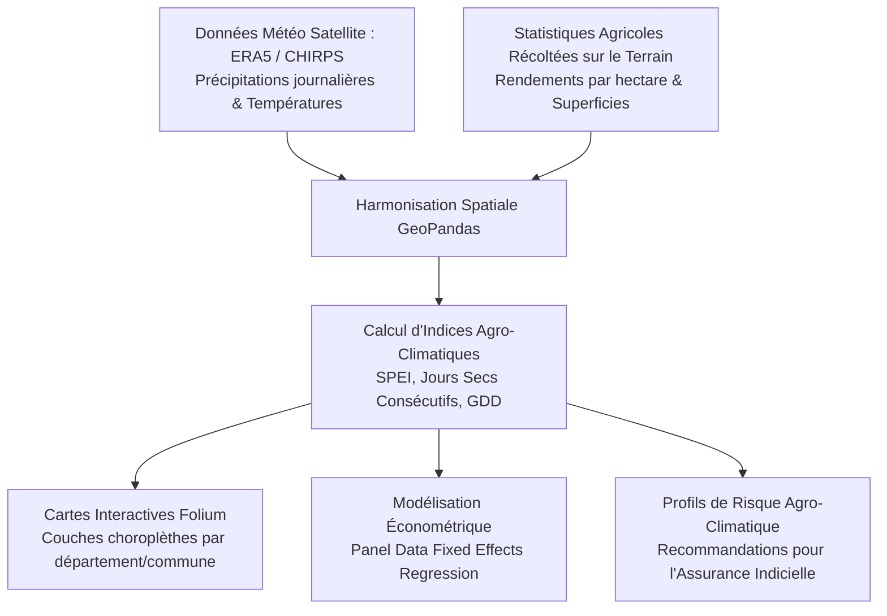

# 🌾 Climate Impact on Agricultural Yields & Geospatial Analysis
[](https://www.python.org/)
[](https://geopandas.org/)
[](https://python-visualization.github.io/folium/)
[](https://plotly.com/)

> **Projet Data Analytics & Économétrie Spatiale**  
> Analyse exploratoire des données (EDA) et cartographie interactive croisant **données météorologiques historiques (températures, précipitations, indices de sécheresse SPEI)** et **statistiques de rendements agricoles régionaux (faisant écho à mes travaux à la Direction de l'Agriculture au Bénin)**. Identification des corridors de vulnérabilité climatique et modélisation économétrique des élasticités de rendement.

---

## 📌 Contexte & Problématique
Le secteur agricole subit de plein fouet les chocs climatiques imprévisibles (irrégularité des moussons, canicules prolongées). Comprendre la sensibilité des cultures vivrières (maïs, manioc, coton) aux variables climatiques locales est crucial pour guider les politiques de subvention et concevoir des produits d'assurance indicielle indicielle agricole.

Issu de mon expérience à la **Direction de l'Agriculture**, ce projet combine statistiques d'enquêtes agricoles et données satellite :
1. **Apurement & Réconciliation de Données Complexes** :
   - Traitement des données d'enquêtes agricoles territoriales (détection de valeurs aberrantes, imputation robuste).
   - Fusion spatio-temporelle avec les réanalyses climatiques ERA5 et CHIRPS à l'échelle communale.
2. **Analyse Exploratoire Multidimensionnelle (EDA)** :
   - Corrélation entre indices de stress hydrique pendant les phases critiques de floraison et baisse de rendement à la récolte.
   - Analyse en composantes principales (ACP) pour regrouper les zones agro-écologiques homogènes.
3. **Cartographie Choroplèthe & Géospatiale Interactive** :
   - Cartes interactives (Folium / GeoJSON) avec couches commutables visualisant les anomalies pluviométriques et les pertes de récolte.
   - Heatmaps de criticité identifiant les bassins d'approvisionnement les plus exposés.
4. **Modélisation Économétrique de Sensibilité** :
   - Régressions à effets fixes par région pour mesurer l'élasticité marginale du rendement par degré Celsius supplémentaire et millimètre de pluie manquant.

---

## 🗺️ Cartographie & Visualisations Réalisées



---

## 📊 Principaux Résultats Analytiques
- **Seuil critique de température** : Au-delà de $34^\circ\text{C}$ pendant la phase de remplissage du grain de maïs, chaque jour de stress thermique additionnel entraîne une **perte de rendement de 3.2%**.
- **Effet de l'irrégularité intra-saisonnière** : Ce n'est pas le volume total annuel de pluie qui dicte la récolte, mais la durée des séquences de jours secs consécutifs (CDD) durant le mois de juin.
- **Cartographie de vulnérabilité** : Les communes du nord et de la zone sahélienne/savane affichent un indice de vulnérabilité agricole supérieur de **38%** à la moyenne nationale.

---

## 📁 Structure du Répertoire
```
├── data/
│   ├── geo/                 # Fichiers GeoJSON des frontières administratives
│   └── agro_climate/        # Séries temporelles météorologiques & rendements
├── notebooks/
│   ├── 01_data_cleaning_and_harmonization.ipynb
│   ├── 02_exploratory_data_analysis.ipynb
│   └── 03_geospatial_mapping_folium.ipynb
├── src/
│   ├── spatial_processing.py
│   └── econometric_panel_model.py
├── output_maps/
│   └── interactive_vulnerability_map.html
├── requirements.txt
└── README.md
```

---

## 🚀 Visualisation Rapide de la Carte

```bash
# 1. Cloner le repository
git clone https://github.com/martin-ahouetognon/climate-agriculture-impact-analysis.git
cd climate-agriculture-impact-analysis
pip install -r requirements.txt

# 2. Générer la carte interactive HTML
python src/spatial_processing.py

# 3. Ouvrir output_maps/interactive_vulnerability_map.html dans votre navigateur
```

---

## 👨‍💻 Auteur
**Martin AHOUETOGNON** - Ingénieur Data Science & IA (ENSAI)  
*Ingénieur Statisticien Économiste (ENEAM)*  
LinkedIn : [Martin Ahouetognon](https://www.linkedin.com) | Email : [ahouetognonmartin@gmail.com](mailto:ahouetognonmartin@gmail.com)
