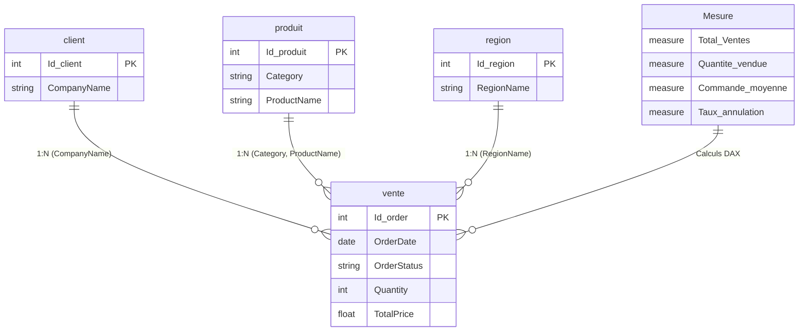

# 📊 Power BI Sales Performance & Order Cancellation Analytics
[](https://powerbi.microsoft.com/)
[](#)
[](#)
[](#)

> **Projet Data Analytics & Business Intelligence Décisionnelle**  
> Conception et modélisation d'un **tableau de bord exécutif sous Power BI Desktop** pour le pilotage des ventes omnicanales et l'analyse causale des commandes annulées. Modélisation relationnelle en schéma en étoile (*Star Schema*), calculs avancés en DAX et restitution visuelle selon les standards UX décisionnels.

---

## 📌 Contexte Métier & Objectifs Décisionnels

Dans le secteur de la distribution et de l'e-commerce, l'augmentation du chiffre d'affaires brut ne suffit pas à garantir la rentabilité : un taux d'annulation élevé entraîne des coûts logistiques superflus, immobilise du stock et détériore l'expérience client.

Ce projet apporte aux directions commerciales et logistiques une double perspective analytique :
1. **Pilotage de la Performance Commerciale (Page Ventes)** : Mesure de la dynamique du chiffre d'affaires, analyse des volumes vendus et décomposition fine par famille de produits et zone géographique.
2. **Diagnostic des Défaillances de Conversion (Page Commandes Annulées)** : Identification des anomalies de taux d'annulation par région, analyse par catégorie de produits et repérage des tendances critiques pour déployer des actions correctives.
3. **Exploration Contextuelle Instantanée (Infobulle Région)** : Visualisation au survol de la dynamique spécifique d'une zone géographique sans quitter la vue macroscopique.

---

## 📈 Indicateurs Clés de Performance (KPIs)

- **Total Ventes** : Chiffre d'affaires global généré sur le périmètre analysé.
- **Quantité Vendue** : Volume d'unités écoulées toutes catégories confondues.
- **Commande Moyenne (Panier Moyen - AOV)** : Montant moyen dépensé par transaction validée.
- **Total Commandes Annulées** : Nombre absolu de commandes ayant avorté avant livraison.
- **Montant Commandes Annulées** : Chiffre d'affaires potentiel non concrétisé (perte d'opportunité).
- **Pourcentage de Commandes Annulées** : Ratio d'attrition opérationnelle (`Commandes annulées / Total commandes`).

---

## 🏗️ Modélisation des Données (Schéma en Étoile - Star Schema)

Le modèle relationnel a été conçu selon les règles d'or de Kimball pour maximiser les performances du moteur VertiPaq :



---

## 📐 Mesures DAX Clés (Extraits)

### 1. Chiffre d'Affaires & Panier Moyen
```dax
Total Ventes = 
SUM(vente[TotalPrice])

Quantité vendue = 
SUM(vente[Quantity])

Nombre de commande = 
DISTINCTCOUNT(vente[Id order])

Commande moyenne = 
DIVIDE([Total Ventes], [Nombre de commande], 0)
```

### 2. Analyse des Défaillances & Taux d'Annulation
```dax
Total de commandes annulées = 
CALCULATE(
    [Nombre de commande],
    vente[OrderStatus] = "Annulé"
)

Montant commandes annulées = 
CALCULATE(
    [Total Ventes],
    vente[OrderStatus] = "Annulé"
)

Pourcentage de commandes annulées = 
DIVIDE([Total de commandes annulées], [Nombre de commande], 0)
```

---

## 🖥️ Organisation des Vues du Rapport

| Page | Type | Visuels Clés Déployés |
| :--- | :--- | :--- |
| **1. Ventes** | Rapport Global | KPI Cards (CA, Volume, Panier Moyen), Graphique combiné (Évolution CA & Quantités), Donut Chart (CA par Catégorie), Bar Chart (CA par Région), Slicers temporels et catégoriels |
| **2. Commandes Annulées** | Analyse Diagnostique | KPI Cards (Volume & % d'annulation, Montant perdu), Clustered Column Chart (% Annulation par Région), Treemap (CA par Catégorie), Courbe d'évolution, Ribbon Chart |
| **3. Infobulle Région** | Tooltip Dynamique | Line Chart contextuel activé au survol de chaque région |

---

## 🚀 Utilisation & Consultation

1. Télécharger le fichier source [`projet_sales.pbix`](../../../projet_sales.pbix).
2. L'ouvrir avec l'application gratuite **Microsoft Power BI Desktop**.
3. Naviguer entre les pages *Ventes* et *Commandes annulées* pour interagir avec les filtres croisés et le modèle en étoile.
