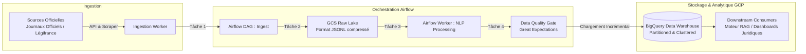

# 🏛️ Automated Legal Texts ETL Pipeline (Airflow, NLP & GCP)
[](https://www.python.org/)
[](https://airflow.apache.org/)
[](https://cloud.google.com/)
[](https://www.docker.com/)

> **Projet Data Engineering & Cloud Architecture**  
> Conception et déploiement d'un **pipeline ETL robuste et entièrement automatisé** pour l'extraction quotidienne, le parsing, le nettoyage NLP et le chargement de textes réglementaires et décrets officiels dans un Data Lakehouse Google Cloud Platform (GCS + BigQuery), orchestré par **Apache Airflow**.

---

## 📌 Objectif & Architecture du Pipeline
L'accès aux publications juridiques et administratives officielles nécessite un flux fiable capable de gérer les variations de format, les erreurs réseaux et les volumétries textuelles sans perte de données.

Ce pipeline implémente l'architecture industrielle suivante :
1. **Extraction (E)** : Web scrapers résilients (Playwright / BeautifulSoup avec gestion de proxies et backoff exponentiel) et connecteurs d'API officielles interrogeant les nouveaux décrets parus chaque nuit.
2. **Transformation (T)** :
   - Nettoyage et normalisation Unicode des textes non structurés.
   - Extraction des entités nommées (NER SpaCy) : ministères, dates d'application, articles de loi abrogés ou modifiés.
   - Découpage en sections juridiques standardisées et calcul de checksums MD5 pour déduplication stricte.
3. **Chargement (L)** : Architecture *ELT / Lakehouse* :
   - Stockage des fichiers bruts et métadonnées en Bronze layer dans **Google Cloud Storage (GCS)**.
   - Insertion incrémentale dans **Google BigQuery** (tables partitionnées par date de publication et clustérisées par thématique juridique).
4. **Orchestration & Observabilité** : DAGs **Apache Airflow** avec gestion des alertes Slack, retries paramétrés, et contrôle de qualité des données avec Great Expectations.

---

## 🏗️ Diagramme de Flux de Données



---

## 🛡️ Robustesse & Bonnes Pratiques
- **Idempotence & Backfilling** : Chaque exécution de DAG est strictement idempotente, autorisant le rejeu sans duplication grâce aux clés naturelles `(source_id, decree_hash)`.
- **Contrôles de Qualité (Data Quality Gates)** : Validation des schémas, tests de non-nullité des champs obligatoires et détection des anomalies de volumétrie.
- **CI/CD & Infrastructure as Code** : Déploiement automatisé des DAGs par GitHub Actions et conteneurisation Docker Compose.

---

## 📁 Structure du Projet
```
├── dags/
│   ├── legal_decrees_etl_dag.py     # DAG principal Airflow
│   └── data_quality_dag.py
├── plugins/
│   ├── hooks/gcp_custom_hook.py
│   └── operators/nlp_cleaner_operator.py
├── src/
│   ├── extractors/
│   │   └── legal_api_client.py
│   ├── transformers/
│   │   └── nlp_normalizer.py
│   └── loaders/
│       └── bigquery_uploader.py
├── docker-compose.yml               # Déploiement local Airflow + Postgres
├── Dockerfile
├── requirements.txt
└── README.md
```

---

## 🚀 Démarrage Rapide

```bash
# 1. Cloner le projet
git clone https://github.com/martin-ahouetognon/legal-texts-etl-pipeline.git
cd legal-texts-etl-pipeline

# 2. Démarrer l'environnement Airflow en local
docker compose up -d

# 3. Accéder à l'interface Airflow
# URL : http://localhost:8080 (identifiants par défaut : airflow / airflow)
```

---

## 👨‍💻 Auteur
**Martin AHOUETOGNON** - Ingénieur Data Science & Ingénierie des Données (ENSAI)  
LinkedIn : [Martin Ahouetognon](https://www.linkedin.com) | Email : [ahouetognonmartin@gmail.com](mailto:ahouetognonmartin@gmail.com)
