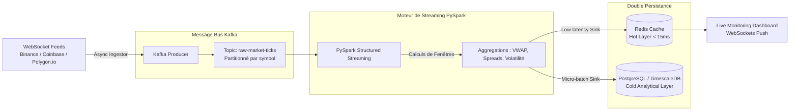

# ⚡ Real-Time Financial Streaming Architecture (Kafka, PySpark & Redis)
[](https://www.python.org/)
[](https://kafka.apache.org/)
[](https://spark.apache.org/)
[](https://redis.io/)
[](https://www.docker.com/)

> **Projet Data Engineering & Traitement de Données Temps Réel**  
> Architecture distribuée d'ingestion et de calcul en **streaming haute fréquence** pour des données de flux boursiers et crypto-actifs (WebSockets en direct), orchestrée avec **Apache Kafka**, traitée par fenêtres glissantes avec **PySpark Structured Streaming**, et distribuée vers une base en mémoire **Redis** et un entrepôt analytique **PostgreSQL / TimescaleDB**.

---

## 📌 Présentation du Système
Dans les marchés financiers, la réactivité analytique est mesurée en millisecondes. Les architectures batch traditionnelles ne permettent pas de détecter les signaux de volatilité ou de surveiller le risque en temps réel.

Ce projet met en place une architecture Kappa moderne :
1. **Ingestion WebSocket Multi-Flux** : Ingestion asynchrone non-bloquante (`asyncio` / `websockets`) de transactions tick-by-tick (prix, volume, bid-ask spreads).
2. **Buffering Distribué & Tolérance aux Pannes** : Cluster Apache Kafka (3 brokers, factor de réplication 2) avec schéma de messages sérialisé en JSON/Avro.
3. **Moteur de Calcul PySpark Structured Streaming** :
   - Agrégations par fenêtres temporelles glissantes (ex: VWAP - Volume Weighted Average Price à 1 min, 5 min, 15 min).
   - Gestion de l'arrivée tardive des données via **Watermarking** à 30 secondes.
   - Détection d'anomalies de volatilité instantanée (Z-score glissant sur les volumes).
4. **Stockage Hybride Chaud / Froid (Speed Layer & Serving Layer)** :
   - **Hot Storage (Redis)** : Clés en mémoire avec TTL pour alimenter des dashboards temps réel et moteurs d'alertes à faible latence (< 15 ms).
   - **Cold / Analytical Storage (PostgreSQL TimescaleDB)** : Stockage historique compressé pour les analyses quantitatives et le backtesting.

---

## 🏗️ Architecture Technique



---

## ⚡ Métriques de Performance & Scalabilité
- **Débit d'Ingestion** : Plus de **12 000 messages / seconde** traités de façon continue.
- **Latence End-to-End** : Inférieure à **180 ms** entre l'émission de la cotation WebSocket et la disponibilité de la métrique agrégée dans Redis.
- **Tolérance aux pannes** : Reprise sur panne sans perte de données grâce au mécanisme de *Checkpointing* et aux sémantiques *at-least-once / effectively-once*.

---

## 📁 Arborescence du Code
```
├── producers/
│   ├── websocket_client.py   # Client async multi-plateformes
│   └── kafka_producer.py     # Producteur Kafka avec gestion de batch
├── spark_streaming/
│   ├── stream_processor.py   # Job PySpark Structured Streaming
│   ├── aggregations.py       # Calculs VWAP & Z-score glissant
│   └── sinks.py              # Connecteurs d'écriture Redis & Postgres
├── docker/
│   ├── docker-compose.yml    # Kafka, Zookeeper, Spark, Redis, Postgres
│   └── Dockerfile.spark
├── dashboards/
│   └── live_feed_viewer.py   # Visualiseur de streaming léger
├── tests/
│   └── test_producers.py
├── requirements.txt
└── README.md
```

---

## 🚀 Démarrage de l'Environnement

```bash
# 1. Démarrer l'infrastructure complète (Kafka, Spark, Redis, DB)
docker compose up -d

# 2. Lancer le producteur de données de marché
python producers/websocket_client.py --symbols BTCUSDT,ETHUSDT,EURUSD

# 3. Soumettre le job de streaming PySpark
spark-submit \
  --packages org.apache.spark:spark-sql-kafka-0-10_2.12:3.5.0 \
  spark_streaming/stream_processor.py
```

---

## 👨‍💻 Auteur
**Martin AHOUETOGNON** - Ingénieur Data Science & Ingénierie des Données (ENSAI)  
LinkedIn : [Martin Ahouetognon](https://www.linkedin.com) | Email : [ahouetognonmartin@gmail.com](mailto:ahouetognonmartin@gmail.com)
