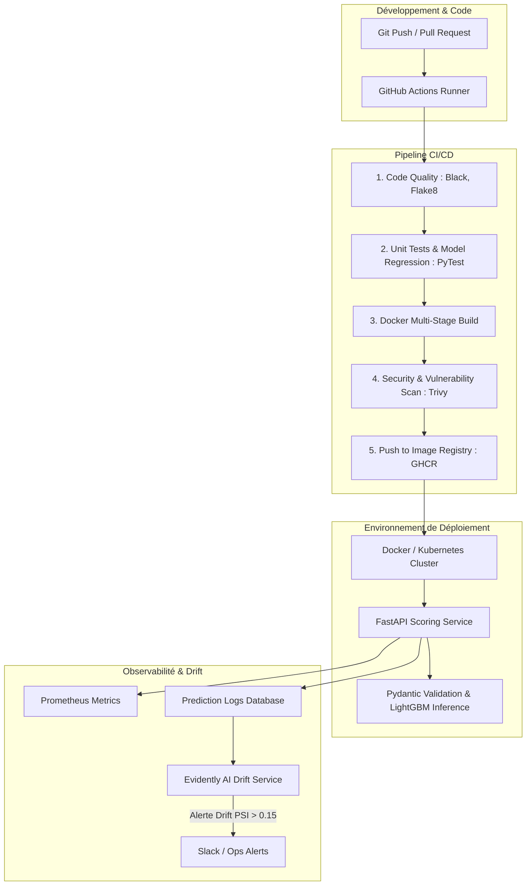

# 🚀 MLOps Production Pipeline for Credit Scoring (FastAPI, Docker & CI/CD)
[](https://www.python.org/)
[](https://fastapi.tiangolo.com/)
[](https://www.docker.com/)
[](https://github.com/features/actions)
[](https://prometheus.io/)

> **Projet Data Engineering & MLOps (DevOps for Machine Learning)**  
> Industrialisation de bout en bout du modèle de risque de crédit et de scoring. Déploiement sous forme de **microservice API REST haute performance avec FastAPI**, conteneurisation légère multi-stage **Docker**, chaîne d'intégration et de livraison continue **CI/CD GitHub Actions**, et monitoring de dérive en temps réel avec **Evidently AI et Prometheus**.

---

## 📌 Présentation & Problématique MLOps
Un modèle de Machine Learning n'apporte de valeur que s'il est capable de délivrer des prédictions fiables, scalables, auditables et monitorées en continu dans un système d'information bancaire.

Ce projet concrétise le passage du modèle de scoring expérimental (Scikit-Learn / LightGBM) à un produit logiciel de production :
1. **API REST FastAPI Asynchrone** :
   - Endpoints de scoring unitaire (`/predict`) et de scoring par lot (`/predict/batch`).
   - Validation stricte des contrats de données d'entrée via des modèles **Pydantic v2**.
   - Temps de réponse moyen inférieur à **12 ms par inférence**.
2. **Conteneurisation Optimisée avec Docker** :
   - Image construite via *multi-stage build* pour réduire l'empreinte mémoire (< 180 Mo).
   - Exécution sous utilisateur non-root pour respecter les standards de sécurité DevSecOps.
3. **Pipeline CI/CD avec GitHub Actions** :
   - **Linting & Formatage** : `flake8`, `black`, `isort`.
   - **Tests Unitaires & Intégration** : `pytest` avec couverture de code minimale imposée (> 90%).
   - **Smoke Tests sur l'API** : Lancement du conteneur et vérification des endpoints critiques.
   - **Build & Push Automatique** : Publication de l'image sur GitHub Container Registry (GHCR) ou Docker Hub.
4. **Monitoring Continu & Détection de Drift** :
   - Export de métriques opérationnelles (latence, RPS, codes HTTP) vers **Prometheus**.
   - Calcul de la dérive statistique des scores et features en production via **Evidently AI** avec alertes webhook en cas de dépassement du seuil de PSI ($PSI > 0.15$).

---

## 🏗️ Architecture MLOps & Pipeline CI/CD



---

## 📡 Spécification des Endpoints de l'API

### `POST /api/v1/score`
**Payload Exemple :**
```json
{
  "applicant_id": "CLI-89342",
  "age": 36,
  "annual_income": 54000.0,
  "credit_amount": 22000.0,
  "emp_length_years": 7.5,
  "debt_to_income_ratio": 0.28,
  "delinq_2yrs": 0
}
```

**Réponse :**
```json
{
  "applicant_id": "CLI-89342",
  "score": 678,
  "pd_12m": 0.0241,
  "decision": "APPROVED",
  "risk_grade": "A2",
  "inference_latency_ms": 7.4
}
```

---

## 📁 Structure du Projet
```
├── .github/workflows/
│   └── cicd_pipeline.yml     # Workflow GitHub Actions automatisé
├── api/
│   ├── main.py               # Application FastAPI
│   ├── schemas.py            # Modèles Pydantic de validation
│   └── routes/
│       ├── scoring.py
│       └── health.py
├── model_artifacts/
│   ├── credit_model.joblib   # Modèle sérialisé et versionné
│   └── preprocessor.joblib
├── monitoring/
│   ├── evidently_drift.py    # Détection de drift hebdomadaire
│   └── prometheus_metrics.py
├── tests/
│   ├── test_api.py           # Tests endpoints TestClient
│   └── test_model_perf.py    # Non-regression tests
├── Dockerfile
├── docker-compose.yml
├── requirements.txt
└── README.md
```

---

## 🚀 Lancement Local via Docker

```bash
# 1. Cloner le projet
git clone https://github.com/martin-ahouetognon/mlops-scoring-fastapi-docker-cicd.git
cd mlops-scoring-fastapi-docker-cicd

# 2. Build et lancement du conteneur
docker build -t credit-scoring-api:latest .
docker run -d -p 8000:8000 --name scoring-service credit-scoring-api:latest

# 3. Tester la documentation interactive Swagger UI
# Ouvrir dans votre navigateur : http://localhost:8000/docs
```

---

## 👨‍💻 Auteur
**Martin AHOUETOGNON** - Ingénieur Data Science & IA (ENSAI)  
LinkedIn : [Martin Ahouetognon](https://www.linkedin.com) | Email : [ahouetognonmartin@gmail.com](mailto:ahouetognonmartin@gmail.com)
