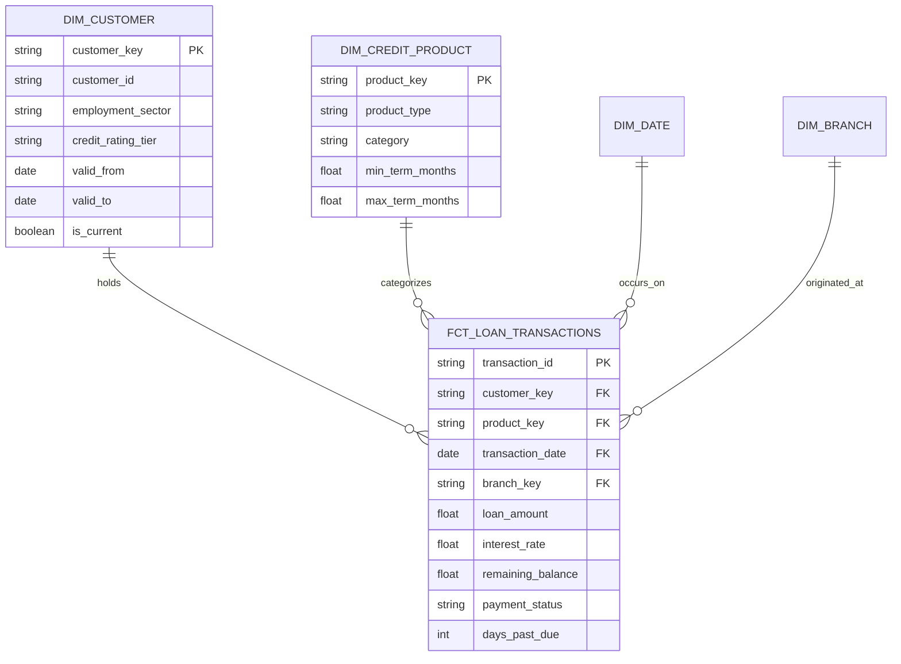
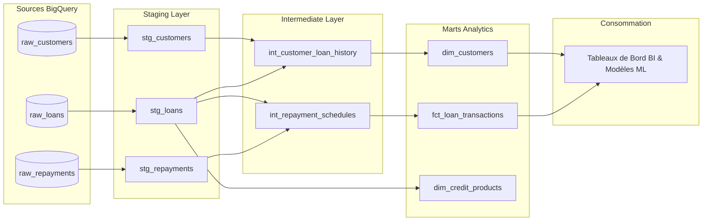

# 🏢 Modern Data Warehouse with dbt & Google BigQuery (Kimball Modeling)
[](https://www.getdbt.com/)
[](https://cloud.google.com/bigquery)
[](#)
[](#)

> **Projet Data Engineering & Analytics Engineering**  
> Conception, modélisation dimensionnelle (schéma en étoile selon la méthodologie **Kimball**) et déploiement d'un **Data Warehouse d'entreprise sur Google BigQuery avec dbt (data build tool)**. Structuration en couches Staging / Intermediate / Marts, tests d'intégrité automatisés, lignage des données et documentation continue.

---

## 📌 Présentation & Approche Méthodologique
Face à l'accumulation de données brutes issues de multiples applications sources (transactions de prêt, interactions clients, paiements, CRM), les organisations ont besoin d'une source unique de vérité (*Single Source of Truth*) performante et optimisée pour les requêtes analytiques.

Ce projet structure un entrepôt de données moderne suivant l'approche **Analytics Engineering** :
1. **Architecture en Couches (Medallion / dbt Standard)** :
   - **`stg_` (Staging - Bronze)** : Vues légères nettoyant les données brutes (renommage cohérent, casting de types, déduplication, conservation de la granularité source).
   - **`int_` (Intermediate - Silver)** : Tables intermédiaires effectuant les jointures complexes, l'enrichissement métier et l'historisation des changements lents (**SCD Type 2** via les *dbt snapshots*).
   - **`fct_` & `dim_` (Marts - Gold)** : Modélisation dimensionnelle en étoile avec tables de faits partitionnées et dimensions dénormalisées prêtes pour la consommation BI.
2. **Optimisation des Coûts & Performances BigQuery** :
   - Partitionnement temporel (`PARTITION BY DATE(transaction_date)`) pour réduire le volume d'octets scannés.
   - Clustérisation sur les clés de requêtage fréquentes (`CLUSTER BY customer_id, product_type`).
3. **Qualité & Gouvernance des Données** :
   - Tests d'intégrité dbt natifs (`unique`, `not_null`, `relationships`, `accepted_values`) et tests personnalisés dbt-utils.
   - Génération continue du catalogue de données et du graphe de lignage (DAG dbt).

---

## 🏗️ Modélisation Dimensionnelle (Star Schema)



---

## ⚡ Graphe de Dépendances dbt (Lineage DAG)



---

## 📁 Structure du Projet dbt
```
dbt_credit_warehouse/
├── dbt_project.yml
├── profiles.yml.example
├── packages.yml              # dbt-labs/dbt_utils, dbt-expectations
├── models/
│   ├── staging/
│   │   ├── src_sources.yml
│   │   ├── stg_customers.sql
│   │   ├── stg_loans.sql
│   │   └── stg_repayments.sql
│   ├── intermediate/
│   │   ├── int_customer_loan_history.sql
│   │   └── int_repayment_schedules.sql
│   └── marts/
│       ├── core/
│       │   ├── schema.yml    # Documentation & Tests de contraintes
│       │   ├── dim_customers.sql
│       │   ├── dim_credit_products.sql
│       │   └── fct_loan_transactions.sql
├── snapshots/
│   └── snap_customers_scd2.sql # Historisation SCD Type 2
├── tests/
│   └── assert_repayment_amount_positive.sql
└── README.md
```

---

## 🚀 Exécution & Déploiement

```bash
# 1. Installer dbt pour BigQuery
pip install dbt-bigquery

# 2. Installer les packages externes dbt (dbt_utils)
dbt deps

# 3. Compiler et exécuter tous les modèles
dbt run

# 4. Lancer tous les tests d'intégrité des données
dbt test

# 5. Générer et visualiser la documentation interactive et le DAG de lignage
dbt docs generate
dbt docs serve
```

---

## 👨‍💻 Auteur
**Martin AHOUETOGNON** - Ingénieur Data Science & Ingénierie des Données (ENSAI)  
LinkedIn : [Martin Ahouetognon](https://www.linkedin.com) | Email : [ahouetognonmartin@gmail.com](mailto:ahouetognonmartin@gmail.com)
