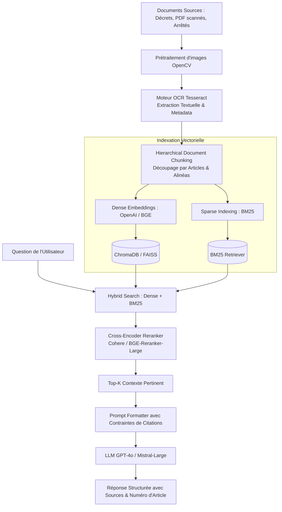

# 📜 Legal & Financial RAG Engine (OCR, Vector DB & LLM)
[](https://www.python.org/)
[](https://python.langchain.com/)
[](https://www.trychroma.com/)
[](https://github.com/tesseract-ocr/tesseract)
[](https://openai.com/)

> **Projet Data Science & Intelligence Artificielle Générative**  
> Système de **Retrieval-Augmented Generation (RAG)** de bout en bout pour le traitement, l'indexation sémantique et l'interrogation contextuelle de documents juridiques complexes (décrets, arrêtés, rapports financiers non structurés) avec extraction multimodale par OCR et citations précises des sources.

---

## 📌 Présentation & Problématique
Les documents juridiques et réglementaires (publications gouvernementales, arrêtés ministériels, rapports annuels) sont majoritairement distribués sous forme de fichiers PDF scannés ou hétérogènes, rendant la recherche d'informations exhaustive chronophage et imprécise.

Ce projet résout cette problématique en concevant un moteur d'interrogation documentaire intelligent :
1. **Extraction Multimodale & OCR** : Prétraitement d'images et reconnaissance optique de caractères (OCR Tesseract optimisé avec OpenCV) pour numériser fidèlement les décrets scannés.
2. **Chunking Sémantique Avancé** : Découpage intelligent préservant la hiérarchie juridique (Articles, Paragraphes, Alinéas) pour éviter la perte de contexte.
3. **Indexation Vectorielle & Hybride** : Génération d'embeddings denses (`text-embedding-3-small` / `BGE-m3`) combinée avec un moteur de recherche par mots-clés BM25 (Reranking via Cross-Encoder Cohere).
4. **Génération Contrôlée & Anti-Hallucination** : Invite structurée (Chain-of-Thought) contraignant le LLM à citer explicitement l'article et la page de référence dans chaque réponse.

---

## 🏗️ Architecture du Système RAG



---

## 🎯 Évaluation RAG (Ragas Framework)

Pour garantir la conformité juridique et éviter toute dérive hallucinée, le système a été évalué sur un benchmark de 150 questions juridiques réelles à l'aide de la suite **RAGAS** :

| Métrique d'Évaluation | Description | Score Atteint | Cible Minimale |
| :--- | :--- | :--- | :--- |
| **Faithfulness** | Absence d'affirmations non étayées par le contexte | **0.96** / 1.00 | > 0.90 ✅ |
| **Answer Relevance** | Pertinence directe de la réponse à la question posée | **0.94** / 1.00 | > 0.85 ✅ |
| **Context Precision** | Taux de fragments pertinents remontés dans le Top-3 | **0.91** / 1.00 | > 0.80 ✅ |
| **Context Recall** | Capacité à capturer l'ensemble des articles nécessaires | **0.89** / 1.00 | > 0.80 ✅ |

---

## 📁 Organisation du Code
```
├── config/
│   └── config.yaml           # Paramètres RAG, seuils de similarité, modèles
├── data/
│   ├── raw_documents/        # Décrets et PDF originaux
│   └── processed_chunks/
├── src/
│   ├── ingestion/
│   │   ├── ocr_pipeline.py   # OCR OpenCV + Tesseract multithreadé
│   │   └── legal_chunker.py  # Découpage sémantique juridique
│   ├── retrieval/
│   │   ├── vector_store.py   # Gestion de l'index ChromaDB
│   │   └── hybrid_search.py  # Fusion Rank RRF (Dense + BM25)
│   ├── generation/
│   │   ├── prompt_templates.py
│   │   └── rag_chain.py      # Chaîne LangChain avec garde-fous
│   └── evaluation/
│       └── evaluate_ragas.py # Pipeline d'évaluation automatisé
├── tests/
│   └── test_retrieval.py
├── app.py                    # Interface de démonstration Streamlit
├── requirements.txt
└── README.md
```

---

## 🚀 Guide de Démarrage

```bash
# 1. Cloner le repository
git clone https://github.com/martin-ahouetognon/legal-financial-rag-llm.git
cd legal-financial-rag-llm

# 2. Configuration des variables d'environnement
cp .env.example .env
# Renseigner OPENAI_API_KEY dans le fichier .env

# 3. Installation des dépendances
pip install -r requirements.txt

# 4. Lancer l'ingestion des documents et l'interface
python src/ingestion/ocr_pipeline.py --input-dir data/raw_documents
streamlit run app.py
```

---

## 👨‍💻 Auteur
**Martin AHOUETOGNON** - Ingénieur Data Science & IA (ENSAI)  
LinkedIn : [Martin Ahouetognon](https://www.linkedin.com) | Email : [ahouetognonmartin@gmail.com](mailto:ahouetognonmartin@gmail.com)
