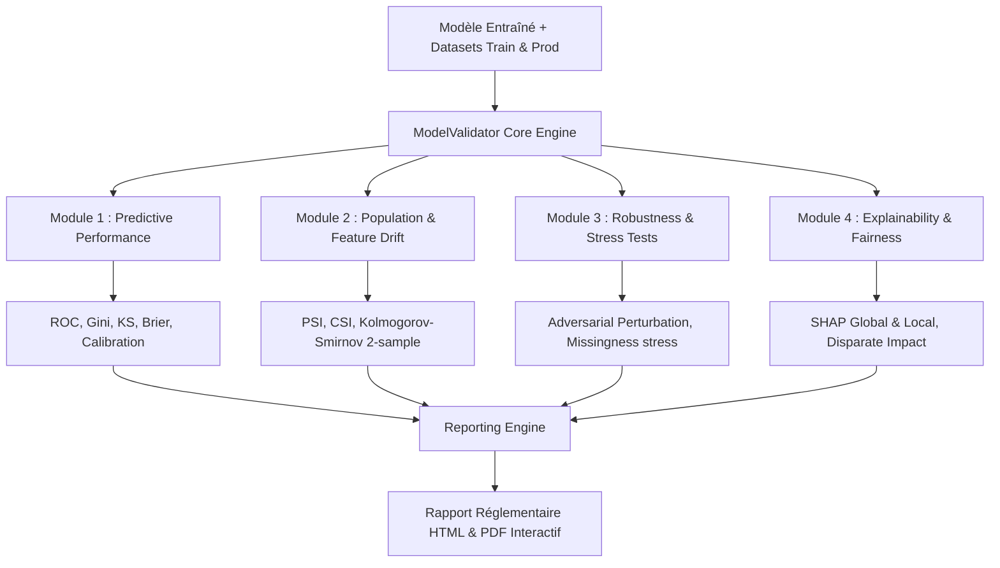

# 🧪 ML Model Validation & Monitoring Framework
[](https://www.python.org/)
[](#)
[](https://github.com/psf/black)
[](https://docs.pytest.org/)
[](#)

> **Projet Data Science & Gouvernance de Modèles (Model Risk Management)**  
> Conception et industrialisation d'un **package Python complet pour l'audit statistique, la validation et le monitoring continu des modèles de Machine Learning** en environnement réglementé (conforme aux exigences de la guidance réglementaire **SR 11-7 / BCE**).

---

## 📌 Contexte & Enjeux Industriels
Dans les institutions financières et bancaires, la mise en production de modèles statistiques ou de Machine Learning est soumise à un examen d'audit rigoureux mené par les équipes de validation indépendante. 

Issu de mon expérience chez **Crédit Logement**, ce framework automatise l'ensemble du cycle de validation technique et génère des rapports d'audit exhaustifs :
1. **Audit de Puissance Prédictive** : ROC-AUC, Gini, Kolmogorov-Smirnov (KS-test), Brier score, lift curves et calibration curves (Brier score decomposition).
2. **Stabilité & Dérive de Population (Drift)** : Calcul automatique du **Population Stability Index (PSI)** et du **Characteristic Stability Index (CSI)** pour chaque variable explicative.
3. **Tests de Robustesse & Stress Testing** : Injection de bruit, analyse de sensibilité, perturbations de données aberrantes (adversarial data shifts).
4. **Interprétabilité & Équité (Fairness)** : Valeurs SHAP (TreeExplainer), calcul de parité démographique et d'impact disparate pour vérifier l'absence de biais algorithmique discriminatoire.
5. **Génération Automatique de Rapports** : Production de rapports PDF / HTML interactifs conformes aux exigences d'audit réglementaire en un seul clic.

---

## 📊 Métriques Clés Implémentées

### 1. Population Stability Index (PSI)
Mesure la dérive de distribution entre l'échantillon de développement ($P$) et l'échantillon d'audit ou de production ($Q$) découpé en $K$ classes :
$$PSI = \sum_{k=1}^K (P_k - Q_k) \times \ln\left(\frac{P_k}{Q_k}\right)$$
- **$PSI < 0.10$** : Pas de dérive notable (Vert 🟢)
- **$0.10 \le PSI \le 0.25$** : Dérive modérée, surveillance requise (Orange 🟡)
- **$PSI > 0.25$** : Dérive critique, ré-étalonnage ou ré-entraînement obligatoire (Rouge 🔴)

### 2. Statistique de Kolmogorov-Smirnov (KS)
Mesure l'écart maximal de séparation entre la fonction de répartition cumulative des bons ($F_{good}$) et des mauvais payeurs ($F_{bad}$) :
$$KS = \max_s |F_{good}(s) - F_{bad}(s)|$$

---

## 🏗️ Architecture du Package `model_validator`



---

## 📁 Structure du Code
```
model-validator-pro/
├── model_validator/
│   ├── __init__.py
│   ├── performance/
│   │   ├── metrics.py        # AUC, Gini, KS, Brier Score
│   │   └── calibration.py    # Calibration curves, Hosmer-Lemeshow
│   ├── drift/
│   │   ├── psi.py            # Calcul PSI matriciel & binning quantile
│   │   └── csi.py            # Diagnostic par feature
│   ├── robustness/
│   │   ├── perturbation.py   # Stress tests et résilience
│   │   └── data_corruption.py
│   ├── explainability/
│   │   └── shap_audit.py     # Feature importance & dépendances
│   └── report/
│       ├── generator.py      # Moteur de template Jinja2 + WeasyPrint
│       └── templates/report.html
├── examples/
│   └── run_credit_model_audit.py
├── tests/
│   ├── test_metrics.py
│   └── test_psi.py
├── pyproject.toml
└── README.md
```

---

## 🚀 Utilisation en 3 Lignes de Code

```python
from model_validator import ModelAuditor

# Initialisation de l'auditeur avec les données de base et de test
auditor = ModelAuditor(
    model=my_credit_model,
    baseline_data=df_train,
    production_data=df_production,
    target_col="default_12m"
)

# Exécution complète de l'audit statistique
audit_results = auditor.run_full_validation()

# Génération du rapport officiel
auditor.export_report("rapport_audit_modele_2026.html")
```

---

## 👨‍💻 Auteur
**Martin AHOUETOGNON** - Ingénieur Data Science & IA (ENSAI)  
*Expérience en Validation de Modèles au Crédit Logement*  
LinkedIn : [Martin Ahouetognon](https://www.linkedin.com) | Email : [ahouetognonmartin@gmail.com](mailto:ahouetognonmartin@gmail.com)
