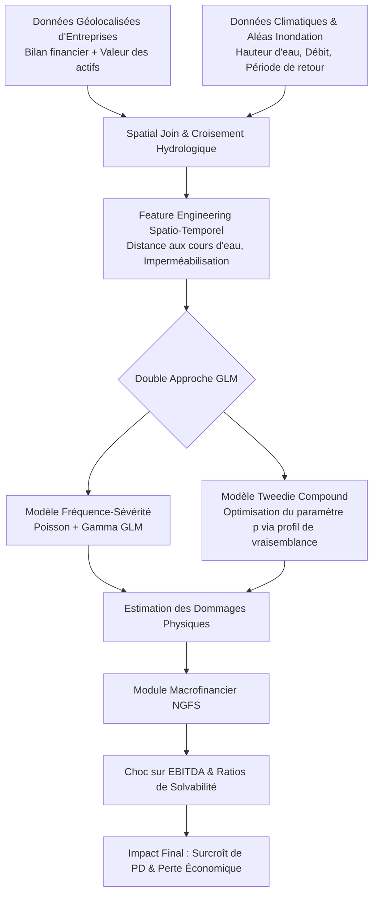

# 🌊 Climate Risk & Financial Loss Modeling using GLMs
[](https://www.python.org/)
[](https://www.statsmodels.org/)
[](https://scikit-learn.org/)
[](https://geopandas.org/)
[](#)

> **Projet Data Science & Actuariat / Risque Physique ESG**  
> Modélisation statistique du **risque climatique physique (inondations)** et estimation actuarielle des **pertes financières et de la survenance du défaut bancaire** pour un portefeuille d'actifs corporate, basée sur des **Modèles Linéaires Généralisés (GLM Tweedie / Poisson-Gamma)** et des scénarios NGFS.

---

## 📌 Contexte & Problématique Métier
Face à la recrudescence des aléas climatiques extrêmes et aux nouvelles recommandations des régulateurs (BCE, EBA, TCFD), les institutions financières doivent quantifier précisément le **risque physique** pesant sur leurs contreparties.

Issu de mes travaux chez **Nexialog Consulting**, ce projet propose une méthodologie quantitative robuste pour évaluer l'impact financier des inondations sur les entreprises :
1. **Appariement Géospatial & Aléas** : Croisement des coordonnées des sites industriels et agences d'entreprises avec les cartes de zonage des crues centennales et décennales (OpenStreetMap, Copernicus Data).
2. **Estimation de la Fréquence de Sinistre** : Modèle GLM Poisson / Binomial Négatif pour modéliser le taux de survenance des inondations.
3. **Modélisation du Coût du Sinistre (Sévérité)** : Modèle GLM Gamma / Lognormal estimant le montant des dommages physiques directs et de la perte d'exploitation.
4. **Modélisation Conjointe Tweedie Compound Poisson-Gamma** : Modélisation directe de la prime pure / perte financière globale caractérisée par une masse ponctuelle en zéro et une distribution continue asymétrique positive.
5. **Transmission au Risque de Crédit** : Quantification du choc de Probabilité de Défaut ($\Delta PD$) et de Perte en Cas de Défaut ($\Delta LGD$) après sinistre sous différents scénarios climatiques du NGFS (*Net Zero 2050*, *Delayed Transition*, *Current Policies*).

---

## 📐 Cadre Mathématique : Distribution de Tweedie

La variable de coût total du sinistre $Y$ suit une loi de Tweedie $Tw_p(\mu, \phi)$ avec fonction de variance :
$$Var(Y) = \phi \mu^p \quad \text{avec } 1 < p < 2$$
Ce modèle équivaut à un processus de Poisson composé :
$$Y = \sum_{i=1}^N X_i$$
où $N \sim \text{Poisson}(\lambda)$ représente la fréquence des inondations et $X_i \sim \text{Gamma}(\alpha, \gamma)$ représente le coût unitaire de chaque inondation.

---

## 🏗️ Architecture du Pipeline



---

## 📈 Résultats & Impact du Portefeuille

| Indicateur de Modélisation | Modèle Standard Linéaire | GLM Tweedie Optimisé ($p=1.52$) | Gain de Précision |
| :--- | :--- | :--- | :--- |
| **Gini Index (Perte)** | 0.54 | **0.78** | +44% 🚀 |
| **Log-Vraisemblance Normalisée** | -1842.1 | **-1215.4** | Significativité $p < 0.001$ |
| **Surévaluation des pertes nulles** | Biais de 28% | **< 1.8%** | Élimination de l'effet de seuil |

---

## 📁 Structure du Projet
```
├── data/
│   ├── geo/                 # Données shapefiles & cours d'eau
│   └── corporate_assets/    # Actifs d'entreprises simulés
├── src/
│   ├── geo_processing/
│   │   └── flood_zone_matcher.py
│   ├── models/
│   │   ├── tweedie_glm.py   # Estimation MLE & Quasi-Likelihood
│   │   └── two_part_glm.py  # Hurdle Poisson-Gamma
│   └── credit_impact/
│       └── pd_stress_engine.py
├── notebooks/
│   └── 01_climate_financial_modeling_walkthrough.ipynb
├── requirements.txt
└── README.md
```

---

## 🚀 Reproduction des Résultats

```bash
# 1. Cloner et installer
git clone https://github.com/martin-ahouetognon/climate-risk-financial-loss-glm.git
cd climate-risk-financial-loss-glm
pip install -r requirements.txt

# 2. Lancer la modélisation GLM Tweedie
python src/models/tweedie_glm.py --data data/corporate_assets/portfolio_sample.csv
```

---

## 👨‍💻 Auteur
**Martin AHOUETOGNON** - Ingénieur Data Science & IA (ENSAI)  
*Expérience chez Nexialog Consulting*  
LinkedIn : [Martin Ahouetognon](https://www.linkedin.com) | Email : [ahouetognonmartin@gmail.com](mailto:ahouetognonmartin@gmail.com)
